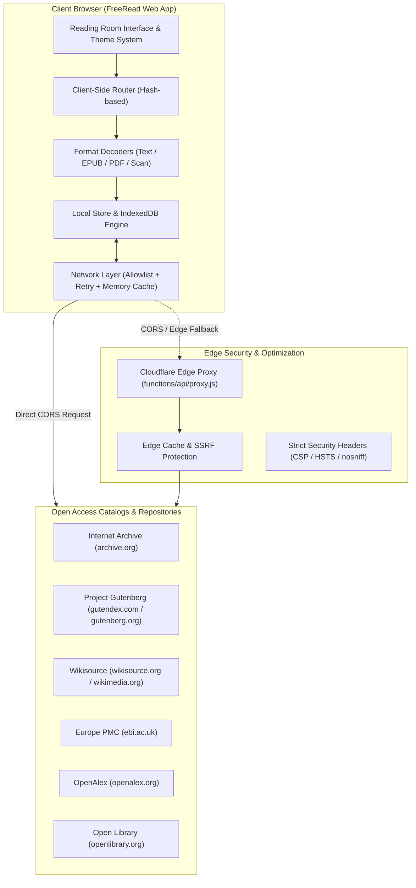

# FreeRead

<p align="center">
  <strong>A private, distraction-free reading room for the open web.</strong><br>
  Discover, search, and read millions of public domain books, scientific research papers, periodicals, and archival texts — entirely inside your browser.
</p>

<p align="center">
  <a href="#license"></a>
  
  
  
  
</p>

---

## Overview

**FreeRead** is an open-source, private reading room engineered for lovers of literature, history, and scientific research. Instead of navigating dozens of separate repositories with fragmented interfaces, paywalls, and telemetry trackers, FreeRead connects you directly to the open web's greatest cultural archives through a single, distraction-free reading space.

Every query runs directly from your device. Your reading history, highlights, shelves, and reading positions never leave your browser.

```
┌────────────────────────────────────────────────────────────────────────┐
│                                FREEREAD                                │
│       A universal reading room with zero tracking and no login         │
├───────────────────┬────────────────────────────────┬───────────────────┤
│    DISCOVERY      │         FORMAT ENGINES         │   LOCAL LIBRARY   │
│  Internet Archive │  Clean Text & Typography Engine │  IndexedDB Store  │
│  Project Gutenberg│  EPUB Reflowable Engine        │  Custom Shelves   │
│  Wikisource       │  PDF Canvas & Text Layer       │  Annotations      │
│  Europe PMC / OA  │  Archival Page Facsimiles      │  Reading Progress │
│  OpenAlex Papers  │  Text Cleanup & Junk Removal   │  JSON Export/Sync │
└───────────────────┴────────────────────────────────┴───────────────────┘
```

---

## Key Features

### 🔍 Federated Catalog Discovery
Search millions of works simultaneously across multiple global digital repositories from a single unified search bar:
- **Internet Archive**: Over 15 million digitized books, rare facsimiles, manuscripts, and periodicals.
- **Project Gutenberg**: Thousands of the world's greatest literary classics and public domain editions.
- **Wikisource**: Collaborative, multilingual library of source texts, translations, and historical documents.
- **Europe PMC**: Millions of open-access biomedical and life sciences research publications.
- **OpenAlex**: Global index of scholarly papers, citations, and scientific monographs.
- **Open Library**: Curated metadata, book cover art, and edition identifiers.

### 📖 Multi-Format In-Browser Engines
FreeRead includes specialized client-side format renderers tailored to the nature of each document:
- **Clean Text Engine**: Formats raw text into elegant book typography. Automatically scrubs legacy Gutenberg boilerplate, removes character corruption (runs of replacement glyphs), and reflows paragraphs.
- **EPUB Engine**: Full reflowable reader with chapter table-of-contents navigation, responsive pagination, and font scaling.
- **PDF Engine**: High-fidelity PDF rendering with selectable text layers, zoom controls, and instant page jumps.
- **Facsimile Viewer**: Archival scan mode for historical books, displaying high-resolution scans directly from preservation archives.

### 🎨 Human-Centered Typography & Ergonomics
Designed specifically to minimize eye strain and maximize immersion during long reading sessions:
- **Three Warm Color Themes**:
  - *Sepia*: Warm ivory and parchment palette inspired by physical paper.
  - *Day*: Clean, high-contrast cream background with dark charcoal ink.
  - *Night*: Deep, warm black with softened amber ink for pitch-black environments.
- **Curated Typefaces**: Choose between *EB Garamond* (classical serif), *Cormorant Garamond* (display serif), *Inter* (neutral sans-serif), and *Atkinson Hyperlegible* (optimized for visual clarity and accessibility).
- **Precision Adjustments**: Sliders for font size, line height, measure (margins), and text justification.
- **True Fullscreen Mode**: Hide browser chrome and interface controls to focus purely on the text.

### 🔒 Privacy by Design & Local-First Storage
- **Zero Telemetry**: No Google Analytics, no Meta Pixel, no user fingerprinting, and no cookies.
- **No Account Required**: No logins, no passwords, and no cloud subscriptions.
- **IndexedDB Persistence**: All your shelves, saved books, reading history, and notes live in your browser's persistent IndexedDB database.
- **Full Data Ownership**: Export your entire library, shelves, and annotations into an open JSON file at any time, or import it into any other browser.

---

## System Architecture



### Edge Security & Proxy Guard
When deployed, FreeRead utilizes an edge function to protect the client and ensure continuous access:
1. **SSRF Mitigation**: Validates target URLs strictly against allowed open-access educational domains; blocks loopback, private RFC-1918 networks, and internal IP ranges.
2. **Subresource Hardening**: Content-Security-Policy (CSP) headers restrict script execution exclusively to trusted engines and subresources.
3. **Bandwidth Optimization**: Responses from public repositories are cached globally at the edge to reduce load on upstream open cultural institutions.

---

## Supported Catalogs & Open APIs

| Repository | Content Type | Capabilities |
| :--- | :--- | :--- |
| **Internet Archive** | Scans, Books, Manuscripts, Audio | Full search, metadata inspection, scan facsimile viewer, PDF streaming |
| **Project Gutenberg** | Classic Public Domain Literature | Full text, EPUB download, clean text parsing |
| **Wikisource** | Historical Documents & Transcriptions | Chapter extraction, multilingual translations, clean HTML parsing |
| **Europe PMC** | Biomedical & Life Sciences Research | Abstract queries, full text XML, PMC paper retrieval |
| **OpenAlex** | Multi-Disciplinary Scholarly Works | DOI resolution, citation graphs, open-access PDF links |
| **Open Library** | Bibliographic Registry & Covers | ISBN/LCCN matching, high-resolution cover retrieval |

---

## Project Structure

```
freeread/
├── index.html              # The complete reading room web application
├── worker.js               # Cloudflare Worker entry point with static asset binding
├── _headers                # HTTP security headers (CSP, HSTS, X-Frame-Options)
├── _routes.json            # Cloudflare Pages routing configuration
├── wrangler.toml           # Cloudflare configuration file
├── package.json            # Project metadata and development scripts
├── LICENSE                 # Apache License 2.0
├── README.md               # Project documentation
└── functions/              # Full-stack edge functions
    └── api/
        ├── proxy.js        # Secure allowlisted edge proxy & CDN cache
        └── health.js       # Service health and edge location monitor
```

---

## Getting Started

### Option 1: Direct File
Because FreeRead is designed to be lightweight, you can simply open `index.html` directly in any modern web browser:
```bash
# Open directly in your browser
double-click index.html
```

### Option 2: Local Development Server
To test edge functions, caching, and security headers locally:

```bash
# 1. Clone the repository
git clone https://github.com/aixenon1-ctrl/freeread.git
cd freeread

# 2. Install dependencies (Wrangler)
npm install

# 3. Start local development server
npm run dev
```

Visit `http://localhost:8788` in your browser.

---

## Keyboard Shortcuts

| Shortcut | Action |
| :--- | :--- |
| `/` or `S` | Jump focus to catalog search bar |
| `Esc` | Close active modal, reader overlay, or drawer |
| `Arrow Left` / `Arrow Right` | Previous page / Next page in reader |
| `J` / `K` | Scroll down / up in text reader |
| `F` | Toggle fullscreen mode |
| `T` | Cycle color theme (Sepia → Day → Night) |

---

## Contributing

Contributions, suggestions, and feature requests are welcome!

1. Fork the Project (`https://github.com/aixenon1-ctrl/freeread/fork`)
2. Create your Feature Branch (`git checkout -b feature/AmazingFeature`)
3. Commit your Changes (`git commit -m 'Add some AmazingFeature'`)
4. Push to the Branch (`git push origin feature/AmazingFeature`)
5. Open a Pull Request

---

## License

Distributed under the **Apache License, Version 2.0**. See [`LICENSE`](LICENSE) for more information.

```
Copyright 2026 aixenon1-ctrl and contributors

Licensed under the Apache License, Version 2.0 (the "License");
you may not use this file except in compliance with the License.
You may obtain a copy of the License at

    http://www.apache.org/licenses/LICENSE-2.0

Unless required by applicable law or agreed to in writing, software
distributed under the License is distributed on an "AS IS" BASIS,
WITHOUT WARRANTIES OR CONDITIONS OF ANY KIND, either express or implied.
See the License for the specific language governing permissions and
limitations under the License.
```
